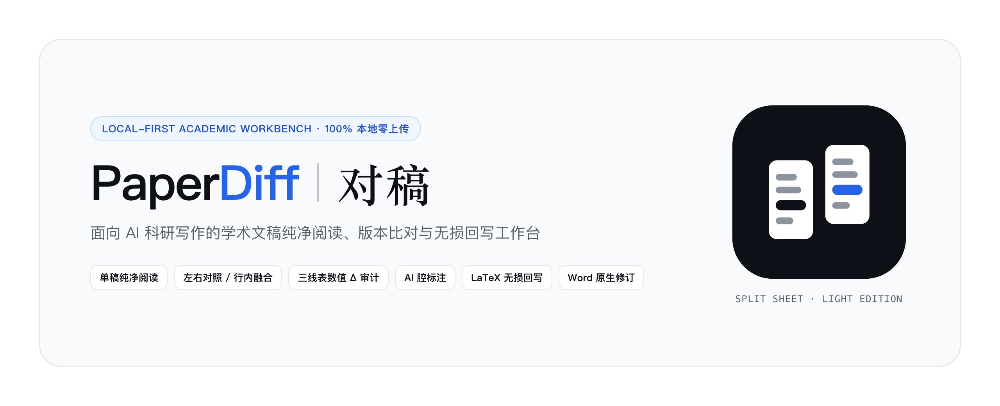
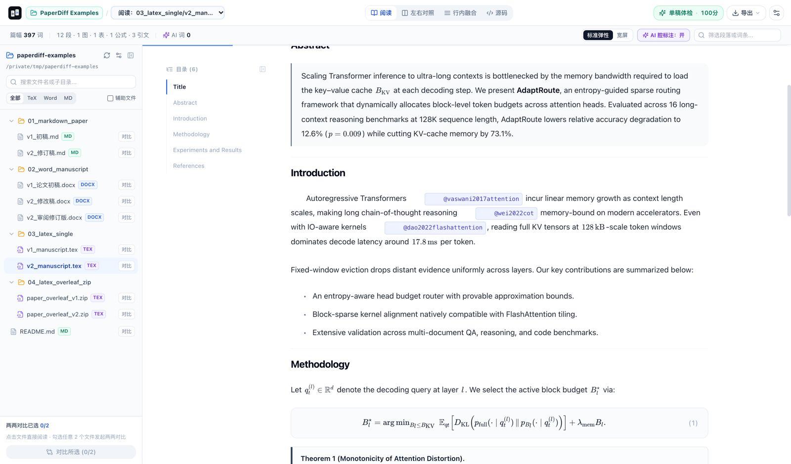
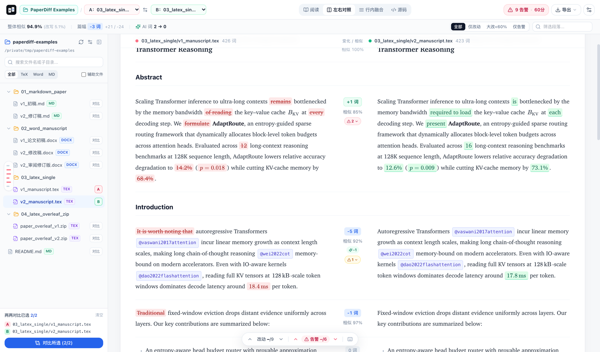
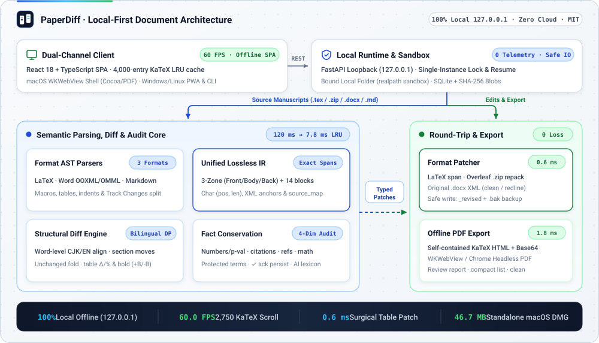

<div align="center">

<picture>
  <source media="(prefers-color-scheme: dark)" srcset="./branding/release/promo-banner-dark.png" />
  <source media="(prefers-color-scheme: light)" srcset="./branding/release/promo-banner-light.png" />
  
</picture>

# PaperDiff (对稿)

**100% Local-First Academic Manuscript Reader, Structural Diff & Lossless Revision Workbench**

[](./CHANGELOG.md)
[](https://github.com/maniac8/PaperDiff/stargazers)
[](#quick-start)
[](#system-architecture)
[](#system-architecture)
[](#quick-start)
[](./LICENSE)
[](#privacy-safety--non-goals)

**English** · [简体中文](./README.zh-CN.md) · [Screenshots](#screenshots) · [Quick Start](#quick-start) · [Workflow](#how-it-works) · [Benchmarks](#benchmarks) · [CLI Reference](#day-to-day-cli--maintenance) · [FAQ](#faq) · [Contributing](./CONTRIBUTING.md)

</div>

<br />

**PaperDiff** is a local-first desktop and browser workbench for reading, comparing, auditing, and revising academic manuscripts across **LaTeX (`.tex / .ltx / .zip`)**, **Word (`.docx`)**, and **Markdown (`.md / .txt`)**.

It runs strictly on `127.0.0.1` with **zero cloud uploads**, **zero external LLM APIs**, and **zero GPL/AGPL dependencies**—KaTeX math rendering, Mermaid diagrams, syntax highlighting, Word original layout preview, and print-grade PDF export all work 100% offline.

| Privacy & Network | 441-Block / 2,750-Formula Scroll | Standalone macOS App | Automated Verification |
| :---: | :---: | :---: | :---: |
| **100% Local Offline**<br><sub>`127.0.0.1` only · 0 telemetry</sub> | **60.0 FPS**<br><sub>`P50 = 16.65 ms` · `P95 = 17.35 ms`</sub> | **46.7 MB DMG**<br><sub>Apple Silicon · 0 runtime deps</sub> | **59 pytest + 14 unit**<br><sub>Incl. real Chrome CDP E2E</sub> |

## Screenshots

### 1. Academic Manuscript Reader

Bind a local manuscript folder directly—browse files and document outlines on the left while reading faithful LaTeX, Word, and Markdown typography (display equations, theorems, macros, figures, and citations) completely offline.

<p align="center">
  <picture>
    <source media="(prefers-color-scheme: dark)" srcset="./assets/screenshots/reader-en-dark.png" />
    <source media="(prefers-color-scheme: light)" srcset="./assets/screenshots/reader-en-light.png" />
    
  </picture>
</p>

### 2. Side-by-Side Two-Manuscript Diff

Select any two manuscript versions (`v1` vs. `v2`) to inspect word-level side-by-side diffs with automatic highlighting of numeric shifts (`14.2% (p = 0.018) → 12.6% (p = 0.009)`, `68.4% → 73.1%`), citation tokens, AI-phrasing edits, and fact-conservation warnings.

<p align="center">
  <picture>
    <source media="(prefers-color-scheme: dark)" srcset="./assets/screenshots/diff-en-dark.png" />
    <source media="(prefers-color-scheme: light)" srcset="./assets/screenshots/diff-en-light.png" />
    
  </picture>
</p>

---

## Quick Start

Choose the installation path for your operating system:

### macOS (Apple Silicon — Standalone `.dmg`, Recommended)

No Python or Node.js installation needed:

1. Download **`PaperDiff-v0.1.0-macOS-arm64.dmg`** from [GitHub Releases](https://github.com/maniac8/PaperDiff/releases).
2. Open the `.dmg` and drag **`PaperDiff.app`** into **Applications**.
3. Launch **PaperDiff** from Applications (or Spotlight).

> [!TIP]
> **First-launch Gatekeeper prompt (unsigned open-source build):** Right-click `PaperDiff.app` → click **Open** → confirm **Open**, or run once in Terminal:
> ```bash
> xattr -dr com.apple.quarantine /Applications/PaperDiff.app
> ```
> **Optional CLI shortcut:** Inside the desktop app, click **CLI (`命令行`)** in the top bar to install `~/.local/bin/paperdiff`. Afterward, run `paperdiff .` in any manuscript folder to jump straight into it, or click **Open in Browser** to share the exact same local session in Safari/Chrome.

### Windows (Cross-Platform Silent Web Mode)

**Prerequisites:**
- **Python 3.11+** — download from [python.org](https://www.python.org/downloads/windows/) *(check **"Add python.exe to PATH"** during setup)*
- **Node.js 20+ LTS** — download from [nodejs.org](https://nodejs.org/)

**1. First-time setup (PowerShell):**

```powershell
git clone https://github.com/maniac8/PaperDiff.git
cd PaperDiff

# Install backend dependencies
pip install -r paperdiff\requirements-dev.txt

# Build the offline frontend bundle
cd paperdiff\frontend
npm ci
npm run build
cd ..\..
```

**2. Daily launch (Zero black terminal window):**

- **Double-click** `启动PaperDiff.bat` in the repository root — automatically launches silently via `pythonw` in the background, reuses any existing instance on the same port, and opens PaperDiff in your default browser.
- **Double-click** `停止PaperDiff.bat` (or click the **Stop** button in the top-right status pill) to shut down the local server cleanly.
- **Or open a specific paper folder directly from PowerShell:**

```powershell
python paperdiff\launch_desktop.py D:\Papers\MyManuscript --daemon
python paperdiff\launch_desktop.py --status
python paperdiff\launch_desktop.py --stop
```

> [!TIP]
> **Make it feel like a native Windows app (PWA):** When PaperDiff opens in **Microsoft Edge** or **Google Chrome**, click the **Install App** icon at the right edge of the address bar to pin PaperDiff to your Windows Taskbar as a standalone borderless window.

<details>
<summary>More installation options (macOS from source, Linux Web mode, and 4 built-in showcase examples)</summary>

#### macOS from Source (Intel / Apple Silicon Developers)

```bash
git clone https://github.com/maniac8/PaperDiff.git
cd PaperDiff
pip install -r paperdiff/requirements-dev.txt
cd paperdiff/frontend && npm ci && npm run build && cd ../..

# Option A: Native macOS desktop window (pywebview / WKWebView)
python3 paperdiff/desktop_app.py

# Option B: Silent background Web mode (or double-click 启动PaperDiff.command / 停止PaperDiff.command)
python3 paperdiff/launch_desktop.py --daemon
```

#### Linux (Web Mode)

```bash
git clone https://github.com/maniac8/PaperDiff.git
cd PaperDiff
pip install -r paperdiff/requirements-dev.txt
cd paperdiff/frontend && npm ci && npm run build && cd ../..
python3 paperdiff/launch_desktop.py --daemon
```

#### Try Immediately with 4 Official Synthetic Examples

The repo ships 4 complete synthetic showcase manuscripts in [`examples/`](./examples/README.md) covering Markdown, Word (with native Track Changes), single-file LaTeX, and multi-file Overleaf `.zip`:

```bash
# macOS / Linux
python3 paperdiff/launch_desktop.py ./examples --daemon

# Windows (PowerShell)
python paperdiff\launch_desktop.py .\examples --daemon
```

</details>

---

## How It Works

### Why Not `git diff`, Overleaf History, or Word Compare?

| Academic Revision Pain Point | Traditional Tools (`git diff` / Overleaf / Word) | How PaperDiff Solves It |
| :--- | :--- | :--- |
| **Noisy line-level diffs** | Re-wrapping a line turns the whole paragraph red; LaTeX markup buries real prose edits | Parses **Markdown / LaTeX / OOXML AST** into semantic blocks and aligns word-level bilingual diffs with unchanged-block folding |
| **Silent factual regressions** | AI polishing or copy-editing silently drifts numbers (`14.2% → 12.6%`), drops `\cite{}` keys, breaks `\ref{}`, or shifts bolded best table metrics | **4-Dimension Local Fact-Conservation Audit** flags numeric/`p`-value/citation/cross-ref/formula/table-bold (`+B/-B`, `Δ/%`)/protected-term shifts with 1-click `✓ Verified` dismissal |
| **Broken templates after editing** | Converting Word/LaTeX through generic exporters destroys covers, headers, grant table borders, and `\toprule` layouts | **Lossless Round-Trip Patching**: surgical LaTeX source-span replacement, Overleaf `.zip` repacking, and in-place original `.docx` XML patching (clean or native `<w:ins>/<w:del>` redline) |
| **Slow large-thesis rendering** | Hundreds of paragraphs and thousands of math formulas lag scroll and window resize | Direct DOM `rAF` progress bar + `content-visibility: auto` + 4,000-entry LRU KaTeX cache + backend LRU parse cache (**locked 60 FPS**) |
| **Privacy & offline constraints** | Cloud diff tools require uploading unpublished manuscripts and grant proposals | **100% local `127.0.0.1` execution**, zero telemetry, zero external LLM APIs, offline KaTeX/Mermaid/PDF export |

### End-to-End 4-Step Daily Workflow

1. **Open a Folder (`Bind Local Folder` or `paperdiff .`)**: Browse all `.tex`, `.zip`, `.docx`, and `.md` files directly from disk inside a canonical root sandbox; edits saved by external editors trigger a clean refresh prompt on window focus.
2. **Read & Calibrate Typography**: Pick **Smart Academic Default** or named Chinese/English presets (customizable indentation, font size, line height, and Light / Warm Sepia / Dark themes).
3. **Compare Any Two Files & Audit Changes**: Check any two files (`A` and `B`) in the sidebar—or click the Track Changes banner on a reviewed `.docx`—to inspect side-by-side / inline / source diffs and review every numeric, citation, math, and table alert.
4. **Edit In-Place & Export Safely**: Double-click any paragraph, equation, caption, or table cell to revise on the spot (editing a table cell automatically scans body prose for stale numbers). Saves default to a `_revised` sibling file; overwriting creates an automatic `.paperdiff.bak` backup. Export back to original `.tex` / `.zip` / `.docx` or generate an offline publication-grade PDF review report.

### System Architecture

PaperDiff follows a decoupled **4-layer Local-First Document Architecture** designed so new input formats, audit rules, or client shells can be added without breaking round-trip fidelity:

<p align="center">
  <picture>
    <source media="(prefers-color-scheme: dark)" srcset="./assets/architecture-dark.svg" />
    <source media="(prefers-color-scheme: light)" srcset="./assets/architecture-light.svg" />
    
  </picture>
</p>

| Layer | Core Stack | Architectural Responsibility |
| :--- | :--- | :--- |
| **1. Dual-Channel Client** | `React 18` · `TypeScript` · `Tailwind CSS` · `KaTeX` · `Mermaid` · `pywebview` | Renders the unified SPA at 60 FPS (`content-visibility: auto`, 4,000-entry KaTeX LRU cache) across macOS native `WKWebView` and cross-platform Web PWA |
| **2. Local Runtime & Sandbox** | `FastAPI` · `Uvicorn` · `SQLite` | Binds exclusively to `127.0.0.1`, manages single-instance port locks & CLI path handoff, and isolates local folder reads inside a canonical `realpath` sandbox |
| **3. Semantic AST, IR & Audit Core** | `pylatexenc` · `python-docx` · `lxml` · `markdown-it-py` · `jieba` | Parses `.tex/.zip`, `.docx`, and `.md` into a 3-zone lossless IR preserving exact character spans & XML anchors; runs bilingual DP diffing and 4-dimension local fact auditing |
| **4. Round-Trip & Delivery Plane** | Surgical Span/XML Patchers · `WKWebView` / Chrome Headless PDF | Applies typed in-place edits directly onto original LaTeX spans, Overleaf `.zip` trees, or `.docx` XML templates (`_revised` + `.bak`), and renders offline self-contained PDF reports |

---

## Benchmarks

Measured by the automated suite [`paperdiff/tests/test_performance_benchmark.py`](./paperdiff/tests/test_performance_benchmark.py) on Apple Silicon macOS (backend + real Headless Chrome CDP):

| Benchmark Scenario | Workload Scale | Measured Result |
| :--- | :--- | :--- |
| **Backend Cold → Warm Parse** | 42.4 KB / 10.6k words / 258 blocks (1,000+ equations, 12 tables) | **120.0 ms** cold → **7.79 ms** LRU cache hit (**15.4× speedup**) |
| **Offline Print HTML Generation** | 794.4 KB self-contained KaTeX offline HTML | **1.8 ms** |
| **50k-Word Stress Manuscript** | 317.6 KB / 34,430 words / 443 blocks | Cold parse **382.3 ms** · Surgical table patch **0.6 ms** · Full diff **2,559.8 ms** |
| **Chrome Read-Mode Fast Scroll** | **441 blocks / 2,750 KaTeX formulas / 56,986 px height** | **P50 = 16.65 ms · P95 = 17.35 ms (locked 60.0 FPS)** |
| **Chrome 16-Step Window Resize** | `1520px → 840px → 1480px` continuous responsive drag | **P50 = 80.26 ms · P95 = 101.49 ms** |
| **Chrome Split-Diff Fast Scroll** | 441-block side-by-side comparison view | **P50 = 19.75 ms · P95 = 36.40 ms** |
| **Standalone macOS `.dmg` Size** | Complete PyInstaller + React + offline KaTeX/Mermaid bundle | **46.7 MB** (`hdiutil verify` + ad-hoc `codesign` passed) |

---

## Day-to-Day CLI & Maintenance

| Task | macOS / Linux | Windows (PowerShell) |
| :--- | :--- | :--- |
| **Start silently in background** | `python3 paperdiff/launch_desktop.py --daemon` | `python paperdiff\launch_desktop.py --daemon` |
| **Open a specific folder / file** | `paperdiff .` *(or `launch_desktop.py /path --daemon`)* | `python paperdiff\launch_desktop.py D:\Papers\Draft --daemon` |
| **Check running port & log path** | `python3 paperdiff/launch_desktop.py --status` | `python paperdiff\launch_desktop.py --status` |
| **Stop local server gracefully** | `python3 paperdiff/launch_desktop.py --stop` | `python paperdiff\launch_desktop.py --stop` |
| **Custom port** | `python3 paperdiff/launch_desktop.py --port 8765 --daemon` | `python paperdiff\launch_desktop.py --port 8765 --daemon` |
| **Double-click launch / stop** | `启动PaperDiff.command` / `停止PaperDiff.command` | `启动PaperDiff.bat` / `停止PaperDiff.bat` |

<details>
<summary>Environment variables &amp; local data storage</summary>

| Environment Variable | Default | Purpose |
| :--- | :--- | :--- |
| `PAPERDIFF_DATA_DIR` | `~/Library/Application Support/PaperDiff` *(packaged macOS)* or `paperdiff/data/` *(source mode)* | Directory holding SQLite DB, deduplicated assets, `server.lock`, `window_state.json`, and rotating `logs/server.log` |
| `PAPERDIFF_PORT` | Auto-selected (`8765` preferred) | Preferred loopback port on `127.0.0.1` |

To uninstall cleanly: delete `PaperDiff.app` (or the cloned repo) and optionally remove your `PAPERDIFF_DATA_DIR`. Your bound local manuscript folders on disk are **never deleted** when removing a project or uninstalling PaperDiff.

</details>

---

## Privacy, Safety & Non-Goals

- **100% local loopback (`127.0.0.1`)**: Zero outbound requests, zero analytics, zero cloud sync, zero external LLM API keys.
- **Canonical path sandboxing**: Local folder bindings validate canonical `realpath` boundaries to block `..` traversal and symlink escapes.
- **Non-destructive writes**: Edits save as `_revised` sibling files by default; overwriting an original file automatically writes a `.paperdiff.bak` backup first.
- **Permissive open-source dependencies only**: Strictly MIT / BSD / Apache-2.0 / ISC / PSF—zero GPL/AGPL dependencies (no LibreOffice, Pandoc, or LaTeXML).
- **Why no PDF import?** PDF is a print-coordinate output format that discards LaTeX/OMML source structure and round-trip edit anchors. PaperDiff intentionally stays source-first (`.tex/.zip`, `.docx`, `.md`) to guarantee clean structural diffs and lossless writeback, while exporting offline publication-grade PDFs for sharing and review.

See [SECURITY.md](./SECURITY.md) for our security architecture and vulnerability reporting policy.

---

## FAQ

### Does PaperDiff upload my unpublished manuscripts or call any AI/LLM APIs?
No. All parsing, diffing, four-dimension fact auditing, KaTeX/Mermaid rendering, and PDF generation run 100% locally on `127.0.0.1`. It works identically with Wi-Fi turned off.

### Will editing a Word thesis or grant proposal break my cover page, headers, or table borders?
No. PaperDiff archives your original `.docx` binary and applies targeted in-place XML patches directly to the original template (`backend/patcher/docx_patcher.py`), preserving covers, fonts, headers/footers, and form borders—and supports exporting either a clean version or native Word Track Changes (`<w:ins>/<w:del>`).

### Is there a Windows `.exe` installer? How should Windows users run PaperDiff?
In `v0.1.0`, Windows runs via the **Cross-Platform Silent Web Mode** (`启动PaperDiff.bat` / `停止PaperDiff.bat`), which launches silently with `pythonw` (no black console window) and supports installing as a standalone Edge/Chrome PWA window.

### Can I use PaperDiff alongside VS Code, LaTeX Workshop, or Overleaf?
Yes. Bind your local LaTeX folder (or unpacked Overleaf repo) in PaperDiff. Keep editing in VS Code or dropping updated Overleaf `.zip` archives into the folder—PaperDiff detects disk changes on window focus and lets you diff any two versions immediately.

### Why does macOS say the developer cannot be verified on first open?
The open-source `.dmg` is ad-hoc signed without a paid Apple Developer ID notarization certificate. Right-click `PaperDiff.app` → **Open** → confirm **Open** once, or run `xattr -dr com.apple.quarantine /Applications/PaperDiff.app`.

---

## Development & Testing

```bash
# 1. Backend & real Headless Chrome CDP E2E suite (59 tests)
cd paperdiff && python3 -m pytest -W ignore -v

# 2. Frontend pure-function unit tests (14 tests) & strict TypeScript build
cd paperdiff/frontend
node --experimental-strip-types --test src/utils/*.test.mjs
npm run build

# 3. Build standalone macOS ARM64 .app & verified .dmg (~47 MB)
/opt/homebrew/bin/python3.12 -u paperdiff/packaging/build_macos_dmg.py
```

### Project Layout

```text
.
├── .github/                      # CI, automated Release DMG pipeline, PR/Issue templates & Dependabot
├── assets/                       # Light/Dark vector architecture SVGs & real UI screenshots
├── branding/release/             # Split Sheet vector brand assets & dual-theme banners
├── examples/                     # 4 official synthetic manuscripts (Markdown / Word / LaTeX / Overleaf ZIP)
├── test_cases/                   # Multi-format stress & regression fixtures
├── README.md / README.zh-CN.md   # Bilingual overview, visual tour & OS onboarding guides
├── CHANGELOG.md                  # Semantic release history
├── CONTRIBUTING.md               # main/dev branching model, PR workflow & coding standards
├── SECURITY.md                   # Local-first security model & vulnerability disclosure
├── LICENSE                       # MIT License
├── 产品使用指南.md                # End-user guide (Chinese)
├── 启动PaperDiff.command / .bat  # One-click silent launch scripts (macOS / Windows)
├── 停止PaperDiff.command / .bat  # One-click graceful stop scripts (macOS / Windows)
└── paperdiff/
    ├── desktop_app.py            # macOS native desktop shell (pywebview / WKWebView)
    ├── launch_desktop.py         # Cross-platform Web daemon launcher & CLI path handoff
    ├── backend/                  # FastAPI server, AST parsers, diff, audit, patcher & PDF export
    ├── frontend/                 # React 18 + TypeScript + Tailwind SPA & PWA assets
    ├── packaging/                # PyInstaller spec & macOS .dmg build script
    └── tests/                    # 59 automated backend, parser, round-trip & Chrome CDP tests
```

## Contributing & License

Pull requests are welcome! PaperDiff uses a protected **`main` + `dev` branching model**—please branch from and target **`dev`** for all feature/fix PRs. See [CONTRIBUTING.md](./CONTRIBUTING.md) for full details.

Released under the [MIT License](./LICENSE).
