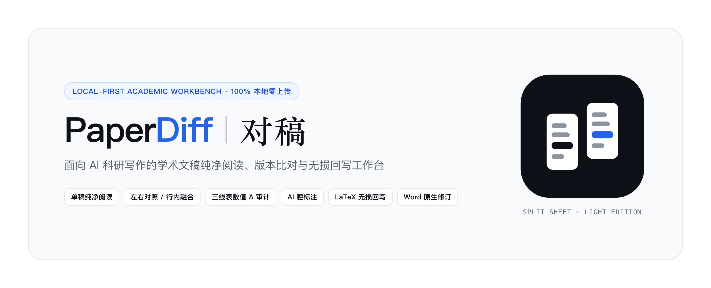
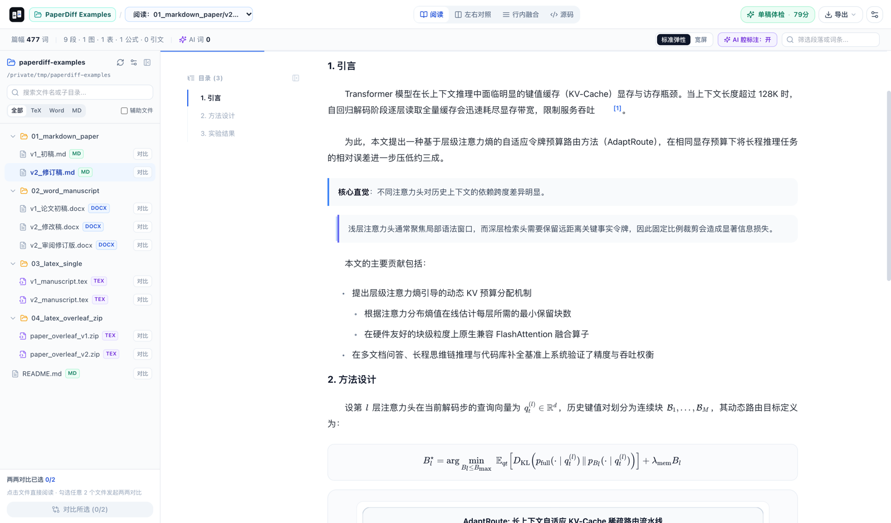
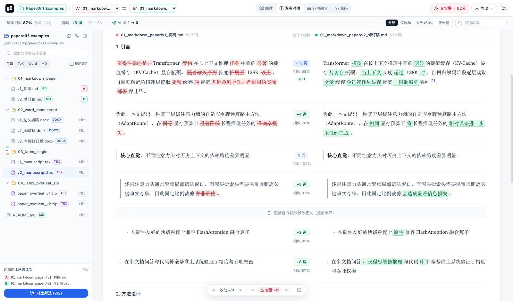
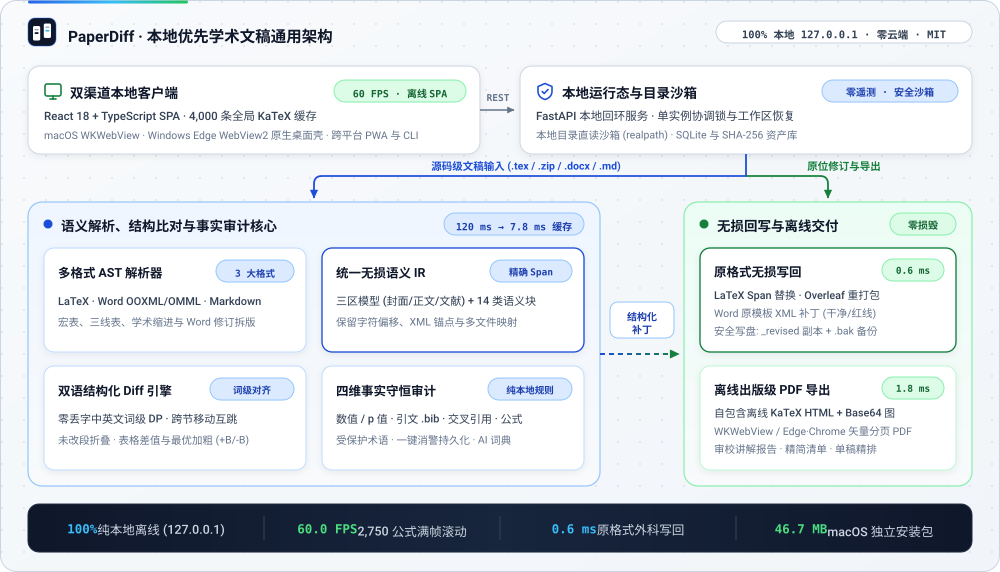

<div align="center">

<picture>
  <source media="(prefers-color-scheme: dark)" srcset="./branding/release/promo-banner-dark.png" />
  <source media="(prefers-color-scheme: light)" srcset="./branding/release/promo-banner-light.png" />
  
</picture>

# 对稿 · PaperDiff

**100% 本地优先的学术文稿阅读、结构化比对与原格式无损修订工作台**

[](./CHANGELOG.md)
[](https://github.com/maniac8/PaperDiff/stargazers)
[](#快速开始)
[](#系统技术架构)
[](#系统技术架构)
[](#快速开始)
[](./LICENSE)
[](#安全隐私与明确边界)

[English](./README.md) · **简体中文** · [界面演示](#界面演示) · [快速开始](#快速开始) · [使用流程](#工作原理与使用流程) · [性能基准](#实测性能基准) · [常用命令](#日常命令与维护) · [常见问题](#常见问题) · [贡献指南](./CONTRIBUTING.md)

</div>

<br />

**对稿 · PaperDiff** 是一款完全在本地运行的学术文稿阅读、版本比对、事实守恒审计与原格式无损修订工具，原生支持 **LaTeX（`.tex / .ltx / .zip`）**、**Word（`.docx`）** 与 **Markdown（`.md / .txt`）**。

只运行在你的电脑本机（`127.0.0.1`），**不联网、不上传文稿、不调用外部大模型 API、零 GPL/AGPL 传染性依赖**——KaTeX 公式、Mermaid 图表、代码高亮、Word 原版排版视图与出版级 PDF 导出在断网状态下均 100% 可用。

| 隐私与网络 | 441 块 / 2,750 公式滚动 | macOS 独立安装包 | 自动化验证 |
| :---: | :---: | :---: | :---: |
| **100% 本地离线**<br><sub>仅监听 `127.0.0.1` · 零遥测</sub> | **锁定 60.0 FPS**<br><sub>`P50 = 16.65 ms` · `P95 = 17.35 ms`</sub> | **46.7 MB DMG**<br><sub>Apple Silicon · 零运行环境依赖</sub> | **59 项 pytest + 14 项单测**<br><sub>含真实 Chrome CDP 端到端</sub> |

## 界面演示

### 1. 论文阅读器（本地目录直读与学术精排）

直接绑定本地论文目录，左侧展示干净的文件树与章节目录，正文忠实保留中英文缩进、公式、图表、定理框与引文渲染（`.docx` 同时支持一键切换「Word 原版」与原生修订痕迹拆版），断网 100% 可用。

<p align="center">
  <picture>
    <source media="(prefers-color-scheme: dark)" srcset="./assets/screenshots/reader-zh-dark.png" />
    <source media="(prefers-color-scheme: light)" srcset="./assets/screenshots/reader-zh-light.png" />
    
  </picture>
</p>

### 2. 双论文对照比对（结构化 Diff 与事实守恒审计）

在目录中勾选任意两份论文版本（`v1` 与 `v2`）即可进入左右对照视图，精准高亮文字增删、数值与 `p` 值变动、表格最优值加粗变化、公式改动与 AI 腔修订，并自动折叠连续未修改段落。

<p align="center">
  <picture>
    <source media="(prefers-color-scheme: dark)" srcset="./assets/screenshots/diff-zh-dark.png" />
    <source media="(prefers-color-scheme: light)" srcset="./assets/screenshots/diff-zh-light.png" />
    
  </picture>
</p>

---

## 快速开始

根据你的操作系统选择最顺手的启动方式：

### macOS 用户（Apple Silicon 独立 `.dmg`，零环境依赖，推荐）

无需安装 Python 或 Node.js：

1. 前往 [GitHub Releases](https://github.com/maniac8/PaperDiff/releases) 下载 **`PaperDiff-v0.1.0-macOS-arm64.dmg`**。
2. 双击打开 `.dmg`，将 **`PaperDiff.app`** 拖入「应用程序」文件夹。
3. 从应用程序或聚焦搜索（Spotlight）直接启动即可。

> [!TIP]
> **首次打开系统安全提示处理：** 开源版采用本地自签名，如 macOS 提示“无法验证开发者”，右键 `PaperDiff.app` → 点击 **「打开」** → 再次确认 **「打开」** 即可；或在终端执行一次：
> ```bash
> xattr -dr com.apple.quarantine /Applications/PaperDiff.app
> ```
> **终端直达与浏览器互通：** 在桌面端顶栏点击 **「命令行」** 可一键安装 `~/.local/bin/paperdiff`，之后在任意论文目录终端运行 `paperdiff .` 即可直达该目录；顶栏还可一键点击 **「浏览器打开」** 共享同一本地端口。

### Windows 用户（跨平台静默 Web 模式，无黑框终端）

**前置环境：**
- **Python 3.11+** — 前往 [python.org](https://www.python.org/downloads/windows/) 安装 *(安装时请勾选 **“Add python.exe to PATH”**)*
- **Node.js 20+ LTS** — 前往 [nodejs.org](https://nodejs.org/) 安装

**1. 首次安装与构建（PowerShell）：**

```powershell
git clone https://github.com/maniac8/PaperDiff.git
cd PaperDiff

# 安装后端依赖
pip install -r paperdiff\requirements-dev.txt

# 构建离线前端静态包
cd paperdiff\frontend
npm ci
npm run build
cd ..\..
```

**2. 日常启动与停止（静默后台，无黑框）：**

- **双击启动**：直接双击仓库根目录的 `启动PaperDiff.bat` —— 自动通过 `pythonw` 在后台静默启动服务、同端口单实例复用，并自动在默认浏览器打开 PaperDiff。
- **双击停止**：双击 `停止PaperDiff.bat`（或在网页右上角状态胶囊中一键点击 **「停止服务」**）即可安全退出。
- **命令行直达指定论文目录（PowerShell）：**

```powershell
python paperdiff\launch_desktop.py D:\Papers\MyManuscript --daemon
python paperdiff\launch_desktop.py --status   # 查看运行端口与日志路径
python paperdiff\launch_desktop.py --stop     # 优雅停止本地服务
```

> [!TIP]
> **获得独立桌面窗口体验（PWA）：** 在 **Microsoft Edge** 或 **Google Chrome** 打开 PaperDiff 后，点击地址栏右侧的 **「将此站点安装为应用」** 图标，即可将 PaperDiff 固定到 Windows 任务栏，以无地址栏独立窗口运行。

<details>
<summary>更多启动方式（macOS 源码开发启动、Linux Web 模式、4 套官方演示案例快速体验）</summary>

#### macOS 源码启动（Intel / Apple Silicon 开发者）

```bash
git clone https://github.com/maniac8/PaperDiff.git
cd PaperDiff
pip install -r paperdiff/requirements-dev.txt
cd paperdiff/frontend && npm ci && npm run build && cd ../..

# 方式 A：启动 macOS 原生独立窗口（pywebview / WKWebView）
python3 paperdiff/desktop_app.py

# 方式 B：后台静默 Web 启动（或直接双击 启动PaperDiff.command / 停止PaperDiff.command）
python3 paperdiff/launch_desktop.py --daemon
```

#### Linux（Web 模式）

```bash
git clone https://github.com/maniac8/PaperDiff.git
cd PaperDiff
pip install -r paperdiff/requirements-dev.txt
cd paperdiff/frontend && npm ci && npm run build && cd ../..
python3 paperdiff/launch_desktop.py --daemon
```

#### 用内置 4 套官方示例 10 秒体验

仓库内置 4 套覆盖 Markdown、Word（含原版修订痕迹）、单文件 LaTeX 与 Overleaf `.zip` 的合成演示稿件（详见 [`examples/README.md`](./examples/README.md)），一条命令即可直接打开体验：

```bash
# macOS / Linux
python3 paperdiff/launch_desktop.py ./examples --daemon

# Windows (PowerShell)
python paperdiff\launch_desktop.py .\examples --daemon
```

</details>

---

## 工作原理与使用流程

### 为什么不用 `git diff`、Overleaf History 或 Word 自带比较？

| 论文改稿常见痛点 | 传统工具（`git diff` / Overleaf / Word） | PaperDiff 的解决方式 |
| :--- | :--- | :--- |
| **源码行比对满屏飘红** | 仅仅改了一个词或重新换行，整段源码标红，公式和宏命令混在文字里根本看不清 | 通过 **Markdown / LaTeX / OOXML 开源 AST** 解析为语义块，中英文词级精准对齐，并自动折叠连续未修改段落 |
| **AI 润色悄悄改坏事实** | 大模型润色常顺手篡改实验数值（`14.2% → 12.6%`）、漏删 `\cite{}` 或 `\ref{}`、把表格最优加粗位挪错 | 纯本地 **四维事实守恒审计** 毫秒级捕捉数值、`p` 值、引文、交叉引用、公式、表格加粗（`+B/-B`、`Δ/%`）与受保护术语变动，支持一键 `✓ 已核对` 消警 |
| **改完导出毁掉原模板** | 普通转换器导出 `.docx` 会把学位论文封面、页眉页脚、基金申报书边框全部冲毁 | **真·原格式无损写回**：LaTeX 精准 Span 外科替换、Overleaf `.zip` 按子文件重打包、基于原始 `.docx` 模板 XML 原位补丁（支持干净版与原生红线修订版） |
| **长论文与上千公式卡顿** | 学位论文或顶会全文含上千个公式，滚动掉帧、拖拽缩放卡死 | 直接 DOM `rAF` 进度条 + `content-visibility: auto` + 4,000 条全局 LRU KaTeX 缓存 + 后端 LRU 缓存（**锁定 60 FPS**） |
| **未发表稿件隐私焦虑** | 在线比对或云端 AI 审校需要上传尚未发表的论文与基金本子 | **100% 本地 `127.0.0.1` 运行**，零遥测、零云端上传、断网全功能可用 |

### 日常改稿 4 步闭环

1. **绑定本地论文文件夹（或 `paperdiff .` 直达）**：免反复上传，在 VS Code / Overleaf / Word 改完文件后切回 PaperDiff 即可收到外部更新提醒并一键同步。
2. **精读校排与双视图核对**：切换「智能学术默认」或中/英文期刊预设，离线检查公式、图表、引文与 `.docx` Word 原版排版。
3. **两两对比与事实守恒核查**：在左侧目录树勾选任意两份稿件（`A` 与 `B`）点击 **「对比已选」**，或在带修订痕迹的 Word 上一键拆版；逐条核查数值、引文、公式与表格变动。
4. **原位修改与安全无损导出**：双击段落、公式、图注或表格单元格直接改稿（改表自动提醒正文遗漏的旧数值）；默认另存 `_revised` 副本，覆盖原稿前自动生成 `.paperdiff.bak` 备份；支持导出原格式 `.tex` / `.zip` / `.docx` 或离线出版级 PDF 审校报告。

### 系统技术架构

PaperDiff 采用解耦的**四层本地优先学术文稿通用架构**，确保新增文稿格式、审计规则或跨平台端壳时无需破坏无损回写闭环：

<p align="center">
  <picture>
    <source media="(prefers-color-scheme: dark)" srcset="./assets/architecture-zh-dark.svg" />
    <source media="(prefers-color-scheme: light)" srcset="./assets/architecture-zh-light.svg" />
    
  </picture>
</p>

| 架构层次 | 核心技术栈 | 核心职责 |
| :--- | :--- | :--- |
| **1. 双渠道本地客户端** | `React 18` · `TypeScript` · `Tailwind CSS` · `KaTeX` · `Mermaid` · `pywebview` | 同一套 60 FPS 离线 SPA（`content-visibility: auto` + 4,000 条 KaTeX 缓存），同时驱动 macOS 原生桌面壳与跨平台 Web PWA |
| **2. 本地运行态与沙箱层** | `FastAPI` · `Uvicorn` · `SQLite` | 仅监听 `127.0.0.1` 回环地址，负责单实例端口协调、CLI 路径直达、`realpath` 本地目录防越界沙箱与 SHA-256 资产去重归档 |
| **3. 语义解析、比对与审计核心** | `pylatexenc` · `python-docx` · `lxml` · `markdown-it-py` · `jieba` | 将 `.tex/.zip`、`.docx`、`.md` 转译为保留精确字符 Span 与 XML 锚点的三区无损 IR，驱动中英词级 DP 比对与四维事实守恒审计 |
| **4. 无损回写与离线交付平面** | 外科 Span / XML 补丁器 · `WKWebView` / Chrome 离线 PDF | 将结构化修改定点回写至原 LaTeX 源码、Overleaf `.zip` 或原 `.docx` 模板（`_revised` + `.bak` 保护），并生成 100% 离线矢量 PDF 报告 |

---

## 实测性能基准

以下数据来自自动化压测套件 [`paperdiff/tests/test_performance_benchmark.py`](./paperdiff/tests/test_performance_benchmark.py) 在 Apple Silicon macOS 上的实测结果（后端 + 真实 Headless Chrome CDP）：

| 测试场景 | 负载规模 | 实测指标 |
| :--- | :--- | :--- |
| **后端冷/热解析（长文）** | 42.4 KB / 10.6k 词 / 258 块（含 1,000+ 公式与 12 张表） | 冷解析 **120.0 ms** → LRU 缓存命中 **7.79 ms**（**15.4× 加速**） |
| **后端离线打印 HTML** | 794.4 KB 自包含 KaTeX 离线 HTML | **1.8 ms** |
| **50k 级压力论文** | 317.6 KB / 34,430 词 / 443 块长论文 | 冷解析 **382.3 ms** · 表格外科写回 **0.6 ms** · 全文 Diff **2,559.8 ms** |
| **Chrome 单稿快速滚动** | **441 块 / 2,750 个 KaTeX 公式 / 56,986 px 文档高** | **P50 = 16.65 ms · P95 = 17.35 ms（锁定 60.0 FPS）** |
| **Chrome 16 步连续拖拽缩放** | `1520px → 840px → 1480px` 跨响应式断点拖拽 | **P50 = 80.26 ms · P95 = 101.49 ms** |
| **Chrome 双栏对比快速滚动** | 同等 441 块双栏 Diff 视图 | **P50 = 19.75 ms · P95 = 36.40 ms** |
| **macOS 独立 `.dmg` 体积** | 完整 PyInstaller + React + 离线 KaTeX/Mermaid 运行包 | **46.7 MB**（通过 `hdiutil verify` 与签名冒烟测试） |

---

## 日常命令与维护

| 常见操作 | macOS / Linux | Windows (PowerShell) |
| :--- | :--- | :--- |
| **后台静默启动** | `python3 paperdiff/launch_desktop.py --daemon` | `python paperdiff\launch_desktop.py --daemon` |
| **直达指定目录或稿件** | `paperdiff .` *(或 `launch_desktop.py /路径 --daemon`)* | `python paperdiff\launch_desktop.py D:\Papers\Draft --daemon` |
| **查看运行端口与日志** | `python3 paperdiff/launch_desktop.py --status` | `python paperdiff\launch_desktop.py --status` |
| **优雅停止本地服务** | `python3 paperdiff/launch_desktop.py --stop` | `python paperdiff\launch_desktop.py --stop` |
| **指定固定端口启动** | `python3 paperdiff/launch_desktop.py --port 8765 --daemon` | `python paperdiff\launch_desktop.py --port 8765 --daemon` |
| **双击启停脚本** | `启动PaperDiff.command` / `停止PaperDiff.command` | `启动PaperDiff.bat` / `停止PaperDiff.bat` |

<details>
<summary>环境变量与本地数据目录说明</summary>

| 环境变量 | 默认位置 | 用途 |
| :--- | :--- | :--- |
| `PAPERDIFF_DATA_DIR` | 打包 macOS 版为 `~/Library/Application Support/PaperDiff`；源码运行为 `paperdiff/data/` | 存放 SQLite 数据库、去重插图缓存、`server.lock`、`window_state.json` 与轮转日志 `logs/server.log` |
| `PAPERDIFF_PORT` | 自动分配（优先 `8765`） | 指定 `127.0.0.1` 优先监听端口 |

彻底卸载只需删除 `PaperDiff.app`（或克隆目录）并按需清理 `PAPERDIFF_DATA_DIR`。移除绑定项目或卸载软件**绝不会删除**你磁盘上原有的本地论文文件夹。

</details>

---

## 安全隐私与明确边界

- **仅监听本机回环（`127.0.0.1`）**：零外网请求、零遥测埋点、零云端同步、零大模型 API 依赖。
- **本地目录安全沙箱**：对所有本地路径做规范路径解析（`realpath`），严防 `..` 路径穿越与越界符号链接读取。
- **安全写盘策略**：原位修改默认另存 `_revised` 副本；选择覆盖原稿时自动先生成 `.paperdiff.bak` 备份。
- **许可洁净红线**：全部依赖仅限 MIT / BSD / Apache-2.0 / ISC / PSF，零 GPL/AGPL 依赖。
- **为什么不做 PDF 导入？** PDF 是面向印刷坐标的终态流格式，丢弃了 LaTeX/OMML 公式源码与无损写回锚点。PaperDiff 聚焦源码级输入（`.tex/.zip`、`.docx`、`.md`）以保证零假阳性比对与原格式无损交付，同时提供出版级离线 PDF 审校报告导出。

详细安全模型与漏洞反馈通道请参阅 [SECURITY.md](./SECURITY.md)。

---

## 常见问题

### 会上传我尚未发表的论文，或者偷偷调用外部 AI API 吗？
不会。所有解析、比对、四维事实审计、公式/图表渲染和 PDF 导出都在本机 `127.0.0.1` 完成，完全断网也能正常运行。

### 在 PaperDiff 里修改 Word 学位论文或基金本子，会破坏封面、页眉和表格边框吗？
不会。PaperDiff 会归档原始 `.docx` 二进制并在原模板 XML 上做定点补丁（`backend/patcher/docx_patcher.py`），完整保留原有封面、字体、页眉页脚与表单边框，且支持导出干净版或原生 Word 红线修订版（`<w:ins>/<w:del>`）。

### Windows 有安装包吗？平时怎么用最方便？
当前 `v0.1.0` 在 Windows 上推荐使用**跨平台静默 Web 模式**：首次配好 Python + Node 构建后，日常直接双击 `启动PaperDiff.bat` 即可无黑框静默启动，再在 Edge / Chrome 中点击「安装为应用」固定到任务栏即可。

### 可以和 VS Code、LaTeX Workshop 或 Overleaf 配合使用吗？
完全可以。在 PaperDiff 中绑定你的本地论文目录即可；平时照常在 VS Code 写稿或从 Overleaf 下载新版 `.zip` 放进目录，切回 PaperDiff 时会自动检测磁盘变更并支持一键对比任意两版。

### macOS 首次打开提示“无法验证开发者”怎么办？
开源 `.dmg` 采用本地自签名，右键 `PaperDiff.app` → 点击「打开」→ 再次确认「打开」一次即可，或在终端执行 `xattr -dr com.apple.quarantine /Applications/PaperDiff.app`。

---

## 本地开发与测试

```bash
# 1. 后端与真实 Chrome CDP 端到端全量测试（59 项）
cd paperdiff && python3 -m pytest -W ignore -v

# 2. 前端纯函数单元测试（14 项）与 TypeScript 严格构建
cd paperdiff/frontend
node --experimental-strip-types --test src/utils/*.test.mjs
npm run build

# 3. 构建 macOS 独立 .app 与签名 .dmg 安装包（约 47 MB）
/opt/homebrew/bin/python3.12 -u paperdiff/packaging/build_macos_dmg.py
```

### 目录结构

```text
.
├── .github/                      # CI、自动发版 DMG 流水线、PR/Issue 模板与 Dependabot
├── assets/                       # 浅/深色矢量系统架构图与实机演示截图
├── branding/release/             # Split Sheet 品牌矢量图标与双态横幅
├── examples/                     # 4 套官方合成演示案例（Markdown / Word / LaTeX / Overleaf ZIP）
├── test_cases/                   # 多格式压力测试与回归样本
├── README.md / README.zh-CN.md   # 中英双语说明、界面演示与全平台安装教程
├── CHANGELOG.md                  # 语义化版本变更记录
├── CONTRIBUTING.md               # main/dev 分支协作、提 PR 指南与代码规范
├── SECURITY.md                   # 本地安全边界与漏洞反馈说明
├── LICENSE                       # MIT 开源协议
├── 产品使用指南.md                # 面向作者的简洁中文使用手册
├── 启动PaperDiff.command / .bat  # macOS & Windows 一键静默启动脚本
├── 停止PaperDiff.command / .bat  # macOS & Windows 一键停止脚本
└── paperdiff/
    ├── desktop_app.py            # macOS 原生桌面壳入口（pywebview / WKWebView）
    ├── launch_desktop.py         # 跨平台 Web 后台启动器与 CLI 路径入口
    ├── backend/                  # FastAPI 本地服务、AST 解析、比对、审计、写回与 PDF 导出
    ├── frontend/                 # React 18 + TypeScript + Tailwind 前端与 PWA 资源
    ├── packaging/                # PyInstaller 配置与 macOS .dmg 打包脚本
    └── tests/                    # 59 项自动化与 Chrome CDP 端到端测试
```

## 参与贡献与开源协议

欢迎提交 Issue 与 Pull Request！本项目采用受保护的 **`main` + `dev` 双分支协作模型**，所有功能与修复 PR 请基于并指向 **`dev`** 分支。详细流程请参阅 [CONTRIBUTING.md](./CONTRIBUTING.md)，终端用户操作说明请参阅 [产品使用指南.md](./产品使用指南.md)。

本项目基于 [MIT License](./LICENSE) 开源。
