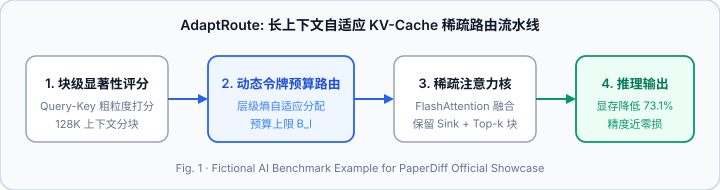

# 面向长上下文大模型推理的自适应 KV-Cache 稀疏路由方法

## 1. 引言

　　Transformer 模型在长上下文推理中面临明显的键值缓存（KV-Cache）显存与访存瓶颈。当上下文长度超过 128K 时，自回归解码阶段逐层读取全量缓存会迅速耗尽显存带宽，限制服务吞吐[^1]。

　　为此，本文提出一种基于层级注意力熵的自适应令牌预算路由方法（AdaptRoute），在相同显存预算下将长程推理任务的相对误差进一步压低约三成。

> **核心直觉**：不同注意力头对历史上下文的依赖跨度差异明显。
>
> > 浅层注意力头通常聚焦局部语法窗口，而深层检索头需要保留远距离关键事实令牌，因此固定比例裁剪会造成显著信息损失。

本文的主要贡献包括：

- 提出层级注意力熵引导的动态 KV 预算分配机制
  - 根据注意力分布熵值在线估计每层所需的最小保留块数
  - 在硬件友好的块级粒度上原生兼容 FlashAttention 融合算子
- 在多文档问答、长程思维链推理与代码库补全基准上系统验证了精度与吞吐权衡

## 2. 方法设计

　　设第 $l$ 层注意力头在当前解码步的查询向量为 $q_t^{(l)} \in \mathbb{R}^d$，历史键值对划分为连续块 $\mathcal{B}_1, \dots, \mathcal{B}_M$，其动态路由目标定义为：

$$
B_l^\star = \arg\min_{B_l \le B_{\max}} \; \mathbb{E}_{q_t}\!\left[ D_{\mathrm{KL}}\!\left(p_{\mathrm{full}}(\cdot \mid q_t^{(l)}) \,\|\, p_{B_l}(\cdot \mid q_t^{(l)})\right) \right] + \lambda_{\mathrm{mem}} B_l
$$

整体在线推理控制流如下：

## 3. 实验结果

　　在 16 项长上下文扩展基准测试集上，本文方法将相对准确率衰减误差进一步降至 12.6%（$p = 0.009$），相较滑动窗口基线提升了 29.8% 的解码吞吐。

| 压缩策略 | 相对误差 (%) | KV 显存节省 (%) | 单 Token 延迟 (ms) |
| :--- | :---: | :---: | :---: |
| 滑动窗口（Sliding Window） | 22.8 | 41.2 | 18.0 |
| 固定比例 Top-k 裁剪 | 18.6 | 53.7 | 19.5 |
| AdaptRoute 自适应路由（本文） | **12.6** | **73.1** | **17.8** |

[^1]: Vaswani, A., Shazeer, N., Parmar, N., et al. (2017). Attention Is All You Need. *NeurIPS 2017*.
